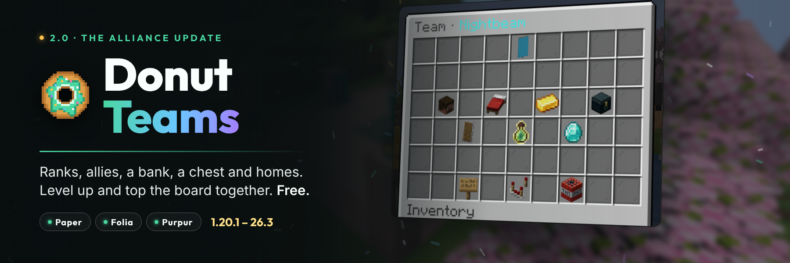

# Donut Teams



A free, open-source team plugin for **Paper**, **Folia** and **Purpur** servers on Minecraft **1.20.1 through 26.3**.

Players make a team, invite friends with a click, and share **homes, a bank and a chest**. Teams rank up their members,
**level up** for more room, make **allies and enemies**, and race up **leaderboards** that stand in your world.
Everything works from menus that you can reshape in `menus.yml`, and on 1.21.7+ text is typed in **native dialogs**
instead of chat. One jar, Folia-safe throughout, SQLite or MariaDB/MySQL.

## Features

- **Teams**: create, invite (clickable **[Accept]**/**[Decline]**), join requests, open teams, leave, kick, transfer,
  rename, disband (the bank and chest go to the owner).
- **Ranks**: Owner, Officer and Member, with twelve team permissions per member (invite, kick, homes, set homes, chat,
  friendly fire, deposit, withdraw, chest, diplomacy, settings, level up).
- **Allies and enemies**: ally requests, war declarations, peace; ally chat; no damage between allies.
- **Team bank** through Vault: deposit, withdraw (`2.5k`, `1m`), history, optional cap.
- **Levels**: teams spend bank money on the next level for more members, homes and chest rows.
- **Team chest**: 1 to 6 shared rows, stored in Paper's versioned item format.
- **Named homes**: as many as the level allows, with a title countdown cancelled by moving or damage.
- **Friendly fire** for teammates and allies: melee, arrows, tridents, pets and harmful potions.
- **Stats and leaderboards**: kills, deaths and KDR; `/team top`; **floating top-teams boards** in the world.
- **Team identity**: colour, icon (any item, banners look great), tag, description, message of the day.
- **Chat**: team chat and ally chat by command, toggle or quick prefix; online/offline notices; staff chat spy.
- **Menus for everything**, fully configurable, with paging, plus **native input dialogs** on 1.21.7+.
- **Staff tools**: disband, force join, kick, set owner, rename, bank, level, open any chest, boards, purge inactive
  teams. All from the console too.
- **Integrations**: PlaceholderAPI (incl. relational placeholders for tab/name tag colours and leaderboards),
  LuckPerms contexts, Vault/VaultUnlocked, DonutCore display names.
- **Developer API**: `DonutTeamsApi` and eleven cancellable events.
- **Safe and fast**: every change is made in memory and saved in order on one database thread; Folia-safe region,
  entity and global scheduling; leaderboards are computed in the background, never on a player's request.

## Requirements

- Paper, Folia, Purpur or another Paper fork, **1.20.1–26.3**. Plain Spigot/Bukkit lack Paper's API: the plugin says
  so and disables itself.
- Java **17+** for 1.20.1–1.20.4, **21+** for 1.20.5–1.21.11, **25+** for 26.x (Minecraft's own requirements).
- Optional: Vault or VaultUnlocked with an economy plugin (bank, levels, create cost), PlaceholderAPI, LuckPerms,
  DonutCore, a MariaDB or MySQL server.

## Installation

1. Put `DonutTeams-2.0.0.jar` in `plugins/`.
2. Restart the server.
3. Edit `plugins/DonutTeams/config.yml`, `messages.yml` and `menus.yml`, then `/donutteams reload`.

### Upgrading from 1.x

Back up `plugins/DonutTeams/`, replace the jar and restart. Teams, members, invites, homes (now named `home`) and
friendly fire are kept; `config.yml` keeps your values (the old file is saved as `config-1.x.yml`); `messages.yml`
is replaced (yours is saved as `messages-1.x.yml`). See the [2.0.0 notes](DonutTeams-2.0.0-PatchNotes.md).

## Commands

`/team` with no arguments opens the menu. Aliases: `/teams`, `/dt`, `/clan`.

| Command | Description |
| --- | --- |
| `/team create [name] [tag]` | Create a team (no name: a dialog or chat prompt) |
| `/team invite <player>` / `uninvite <player>` | Invite a player / take an invite back |
| `/team join <team>` / `decline <team>` | Accept an invite or join an open team / decline |
| `/team request <team>` | Ask to join |
| `/team accept <player>` / `deny <player>` | Answer a join request |
| `/team leave` / `kick <player>` | Leave / kick a lower rank |
| `/team promote <player>` / `demote <player>` | Change a member's rank (owner) |
| `/team transfer <player>` | Hand the team over (owner) |
| `/team disband` | Disband (owner; asks to confirm) |
| `/team info [team]` / `list` / `top [kills\|balance\|level\|members]` | Details, all teams, leaderboards |
| `/team chat [message]` (`/tc`) / `allychat [message]` (`/ac`) | Team / ally chat, or toggle it |
| `/team home [name]` / `sethome [name]` / `delhome [name]` / `homes` | Team homes |
| `/team bank` / `deposit <amount>` / `withdraw <amount>` / `balance` | Team bank |
| `/team chest` (`ec`, `vault`) | Team chest |
| `/team level [up]` | Levels, and buying the next one |
| `/team ally <team>` / `enemy <team>` / `neutral <team>` / `relations` | Diplomacy |
| `/team pvp` / `allypvp` / `open` | Friendly fire, ally damage, open joining |
| `/team rename <name>` / `tag <tag>` / `color <colour>` / `icon` | Name, tag, colour, icon (held item) |
| `/team description <text>` / `motd <text>` / `settings` | Description, message of the day, settings menu |

### Staff (`/donutteams`, `/dteams`, `/teamadmin`)

| Command | Description |
| --- | --- |
| `reload` | Reload config, messages and menus |
| `info [team]` / `version` | Install report, or a team's details |
| `disband <team>` | Disband any team |
| `join <player> <team>` / `kick <player>` / `setowner <team> <player>` | Membership |
| `rename <team> <name> [tag]` | Rename a team |
| `bank <team> <set\|give\|take> <amount>` / `level <team> <level>` | Bank and level |
| `chest <team>` | Open any team's chest |
| `spy` | Read every team and ally chat |
| `board create <name> [kills\|balance\|level\|members]` / `board delete <name>` / `board list` | Floating top-teams boards |
| `purge <days> [confirm]` | Disband teams nobody played on for that long |

## Permissions

| Permission | Default | Description |
| --- | --- | --- |
| `donutteams.use` | everyone | `/team` and the menus |
| `donutteams.create` | everyone | Create a team |
| `donutteams.chat` | everyone | Team chat and ally chat |
| `donutteams.home` | everyone | Team homes (the rank must allow it too) |
| `donutteams.slots.<n>` | nobody | The owner's team can have `n` members (up to `max-members-cap`) |
| `donutteams.bypass.cost` | op | Create a team for free |
| `donutteams.bypass.warmup` | nobody | Instant team home |
| `donutteams.bypass.cooldown` | op | No team home cooldown |
| `donutteams.bypass.friendlyfire` | nobody | Hurt teammates and allies anyway |
| `donutteams.admin` | op | `/donutteams` and update notices |
| `donutteams.admin.spy` | op | Chat spy |

Team permissions (what each rank may do inside a team) are set per rank in `config.yml` and per member in the member
menu.

## Placeholders

Requires PlaceholderAPI. All read memory only.

| Placeholder | Value |
| --- | --- |
| `%donutteams_has_team%` | `true` / `false` |
| `%donutteams_name%`, `%donutteams_name_formatted%` | Team name (plain / in the team colour) |
| `%donutteams_tag%`, `%donutteams_tag_formatted%` | Tag (plain / `[TAG]` in colour) |
| `%donutteams_color%`, `%donutteams_color_code%` | Colour name / colour code |
| `%donutteams_role%`, `%donutteams_role_formatted%` | The player's rank |
| `%donutteams_owner%` | Owner name |
| `%donutteams_members%`, `%donutteams_members_online%`, `%donutteams_max_members%` | Member counts |
| `%donutteams_level%` | Level |
| `%donutteams_balance%`, `%donutteams_balance_formatted%`, `%donutteams_balance_short%` | Bank (`12500.00`, `$12,500.00`, `12.5k`) |
| `%donutteams_kills%`, `%donutteams_deaths%`, `%donutteams_kdr%` | Team stats |
| `%donutteams_player_kills%`, `%donutteams_player_deaths%` | The player's own stats |
| `%donutteams_allies%`, `%donutteams_enemies%`, `%donutteams_homes%`, `%donutteams_max_homes%` | Counts |
| `%donutteams_rank_kills%` (`_balance`, `_level`, `_members`) | The team's position |
| `%donutteams_top_<stat>_<n>_name%` (`_name_formatted`, `_tag`, `_value`) | Leaderboards (`kills`, `balance`, `level`, `members`) |
| `%donutteams_open%`, `%donutteams_pvp%`, `%donutteams_description%`, `%donutteams_motd%`, `%donutteams_chat_mode%` | Settings |
| `%rel_donutteams_relation%`, `%rel_donutteams_relation_formatted%` | Teammate / Ally / Neutral / Enemy |
| `%rel_donutteams_relation_color%` | Green / aqua / gray / red colour code, for tab and name tags |
| `%rel_donutteams_tag%`, `%rel_donutteams_tag_bracketed%`, `%rel_donutteams_name%` | The other player's team, in the relation colour |

LuckPerms contexts: `donutteams:has-team`, `donutteams:role` (`owner`, `officer`, `member`, `none`) and
`donutteams:team`.

## Configuration

- `config.yml`: storage, name rules, create cost, rank permissions, **levels**, homes, chat, friendly fire,
  relations, bank, chest, stats, leaderboards, notifications, sounds.
- `messages.yml`: every message, MiniMessage or `&` codes. An empty message is not sent.
- `menus.yml`: every menu's title, size, slots, items, names and lore.

Storage is SQLite by default. For MariaDB or MySQL set `storage.type: MARIADB` and the connection details; one
server per database (several servers sharing teams is NightTeams Pro's job).

## Developer API

```java
DonutTeamsApi api = DonutTeams.getApi();
api.teamByPlayer(player.getUniqueId()).ifPresent(team -> player.sendMessage("You are in " + team.name()));
if (api.relation(attacker.getUniqueId(), victim.getUniqueId()) == Relation.ALLY) { ... }
```

Events (all cancellable): `TeamCreateEvent`, `TeamJoinEvent`, `TeamLeaveEvent`, `TeamDisbandEvent`,
`TeamRoleChangeEvent`, `TeamRelationChangeEvent`, `TeamBankTransactionEvent`, `TeamHomeTeleportEvent`,
`TeamLevelUpEvent`, `TeamRenameEvent`, `TeamChatEvent`.

## Building and testing

```bash
./gradlew build            # the jar in build/libs, unit tests, and Folia-safety checks
./gradlew compileMatrix    # compile against every Paper API from 1.20.6 to 26.3
```

[`tools/smoke`](tools/smoke) boots real Paper and Folia servers from 1.20.1 to 26.3 and plays the plugin with bots,
including an upgrade from 1.0.1 and MariaDB storage. [`tools/marketing`](tools/marketing) captures the listing's
screenshots from the real game.

## Contributing

See [CONTRIBUTING.md](CONTRIBUTING.md) and [CODE_OF_CONDUCT.md](CODE_OF_CONDUCT.md).

## Security

See [.github/SECURITY.md](.github/SECURITY.md).

## License

Licensed under the [Apache License, Version 2.0](LICENSE).
